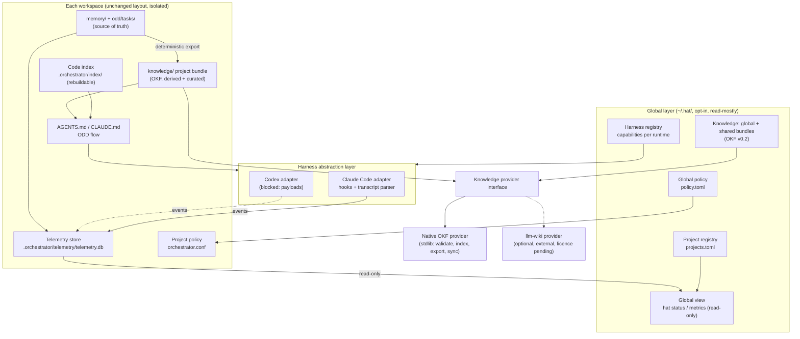

# Target architecture: from workspace orchestrator to meta-harness

Status: proposal, not approved (2026-11-06). Reads with [audit.md](audit.md) (what exists) and
[roadmap.md](roadmap.md) (order and tasks).

## 1. Design rules taken from the brief and the history

- **Evolve, don't rewrite.** Every new component starts as a file format or a script next to the ones that exist
  (`telemetry.py`, `odd_tasks.py`, `memory-check.py`), standard library only, tested in `tests/`.
- **Coordination must cost less than it saves.** Baseline (one workspace, 2026-10-12..23): the orchestrator
  session already used 51 % of all tokens. Nothing below may add model turns or context by default; each
  feature names its token cost and is measured with the F1 telemetry before it becomes a default.
- **Deterministic first.** Registry, index, lint, export, sync, metrics and policy checks never call a model.
  A model is used only to *write* knowledge or code, on a human-started task.
- **Human-started sessions stay the default.** The meta-harness plans, routes and records. Launching a harness
  headless (`claude -p`, `codex exec`) spends quota and is opt-in per task.
- **Markdown stays the source of truth** for decisions, state and knowledge; SQLite only for telemetry and
  derived indexes that can be rebuilt.

## 2. Components

Dashed: blocked or optional. Arrows into `GUIDE` mean "the orchestrator may read it, on demand", never "loaded
into every session".

### A. Meta-harness core

The brief lists nine managers. Most of them already exist in a simpler shape; the proposal is to name and
finish them, not to add a service:

| Brief | Today | Proposal |
|---|---|---|
| Project manager | a workspace = one root | `~/.hat/projects.toml`: id, root, repos, harnesses, knowledge shares. Added by the user (`hat project add`), never discovered by scanning |
| Harness registry | `.claude/` and `.codex/` by convention | `capabilities()` per adapter (below), checked by `hat doctor` |
| Task / plan manager | `odd/tasks/<feature>.md`, `odd_tasks.py` | unchanged; F5 reads it across projects |
| Dependency manager | *Depends on* column in task files | a deterministic topological check (cycles, blocked tasks) in `odd_tasks.py` |
| Execution manager | the human starts a session; the orchestrator delegates to agents | opt-in headless dispatch per task, through the adapter's `execute`, only after F4 |
| Event coordination | telemetry events v1 | same contract; add `project_id` everywhere it's missing and a `harness` field when Codex lands |
| Global configuration | `orchestrator.conf` per workspace | `~/.hat/config.toml` holds only defaults a workspace can override; never the reverse |
| Recovery / state | task files + run log + telemetry pending queue | unchanged; F5 adds a cross-project "what is in flight" view |

### B. Harness abstraction layer

A contract of **capabilities**, not a lowest common denominator. Each adapter declares what it really supports;
callers check before using.

| Capability | Claude Code (verified) | Codex (to verify) |
|---|---|---|
| `health_check` | `claude --version`; hooks present in `.claude/settings.json` | `codex --version`; `.codex/hooks.json` |
| `collect_events` | hooks SessionStart/End, SubagentStart/Stop, PostToolUse(+Failure) → `telemetry.py hook claude` | SessionStart hooks exist; usage payloads unknown |
| `usage` | transcript parser (private format, versioned, `unavailable` on unknown shapes) | unknown: no invented fields |
| `execute` | `claude -p` (headless; spends quota) | `codex exec` (spends quota) |
| `status` / `cancel` | process-level only (pid of a headless run) | process-level only |
| `capabilities` | static table in the adapter, checked by tests | same |

Shape: one Python module per adapter (`adapters/claude.py`, `adapters/codex.py`) exposing a dict of callables;
no base class until a third runtime exists.

### C. Project and workspace management

- A **project** is a workspace root with its own `.orchestrator/`. It never needs another project to be
  installed: the global layer is optional, and a workspace works exactly as today without `~/.hat/`.
- **Isolation by default.** Each project keeps its own telemetry store, memory, knowledge bundle, code index and
  policy. The global view opens project stores **read-only** and only those in the registry.
- **No cross-project writes.** Sharing happens by copying exported, allowlisted knowledge into
  `~/.hat/knowledge/shared/<share>/`, never by one project reading another's files.

## 3. Knowledge platform

### 3.1 OKF: what it really is (checked 2026-11-06)

Source: `GoogleCloudPlatform/knowledge-catalog` › `okf/SPEC.md` (Apache-2.0).

- Current version is **v0.2** (migrated 2026-07-24, timestamps tightened 2026-08-21). v0.1 dates from June 2026.
- A bundle is a directory of Markdown files with YAML frontmatter; the path is the identity; `index.md` and
  `log.md` are reserved. The only required key is `type`. Recommended: `title`, `description`, `resource`, `tags`.
- v0.2 adds optional families: provenance `sources[]` (`id`, `resource`, `title`, `author`, `usage_count`,
  `last_modified`, `usage_window`) with per-claim footnotes keyed by `sources[].id`; trust `generated: {by, at}`
  and `verified: [{by, at}]` with derived tiers (unverified / machine-confirmed / human-reviewed); lifecycle
  `status: draft|stable|deprecated` and `stale_after`; an `Attested Computation` type.
- Actors: `<producer>/<version>`, `human:<id>`, `process:<id>`.
- Conformance is permissive: consumers must not reject unknown keys, unknown types or broken links; unknown
  keys should be preserved on round-trip.
- **v0.1 → v0.2 is not compatible in both directions.** Breaking: `timestamp` → `generated.at`, body
  `# Citations` → `sources`. A v0.2 consumer may read v0.1 through fallbacks; a v0.1 consumer won't understand
  v0.2 provenance.
- Maturity: two minor versions in five months, driven by one vendor, first adopter its own catalog. Expect more
  changes; pin the version per bundle (`okf_version` in the root `index.md`).

### 3.2 szaghi/llm-wiki: what it really is (checked 2026-11-06)

- A **personal corpus** (16 bundles of CFD/numerics literature) plus Python tools, a Claude Code skill and
  plugin, and a VitePress site. Created 2026-07-08, last push 2026-11-02, 0 stars, one maintainer.
- **Licence: none.** GitHub reports no licence and `LICENSE` returns 404. Without a licence, its code can't be
  copied, vendored or redistributed. This blocks "integrate as first implementation" in any form other than
  "the user installs it themselves and we call it".
- **Not an MCP server, no API.** The interface is `python3 tools/<name>.py` scripts and `make` targets:
  `lint_okf.py <bundle>/wiki`, `bundles.py --write|--check`, `bib_to_md.py [--pending]`, `bib_merge.py
  [--dupes]`, `site_sync.py`, `worklist.sh`; `make check|lint|test|docs`. Dependency: PyYAML; Python ≥ 3.11.
- **Deterministic parts**: the linter (frontmatter, `type` vs folder, kebab-case names, links, index
  completeness, bibliography sync, orphans), bibliography tools, the bundle registry.
- **LLM parts (Claude Code only)**: reading sources, extracting concepts, writing and merging pages,
  contradictions, notation maps, a periodic "deep lint". The protocol lives in `CLAUDE.md` addressed to Claude
  Code; there is no `AGENTS.md`. Codex could read the files and follow `CLAUDE.md` as plain text, but nothing is
  documented or tested for it.
- **Query** = navigation from `index.md` plus grep. No embeddings.
- **OKF**: declares v0.1 (`okf_version: "0.1"`, `timestamp`, `# Citations`), so it is **v0.1, not v0.2**. Its
  `status: established|hypothesis` (claim kind) **collides** with v0.2 `status: draft|stable|deprecated`
  (lifecycle): a v0.2 consumer would misread every page.
- **Domain fit**: built for scientific literature (BibTeX, DOIs, notation maps, KaTeX). Our knowledge is
  architecture, decisions and project context: most of its rules (bibliography, notation, `type` taxonomy of
  Definition/Method/Operator…) don't apply.
- **Worth reusing as ideas**: atomic ingestion per source with a log entry, "a source is ingested iff its
  Source page exists" (resumable worklist), contradictions recorded both sides and never overwritten, the
  compiler never commits (the human does), deep lint on a cadence, not on every change.

**Conclusion**: llm-wiki is a good *reference design* and a possible *optional provider* for users who install
it; it is not a dependency we can ship, and it doesn't target the OKF version we should target.

### 3.3 Knowledge provider interface

Named after what the tools can really do, with capabilities declared per provider:

| Operation | Meaning | Model? | Native provider (proposed) | llm-wiki provider |
|---|---|---|---|---|
| `validate(bundle)` | OKF conformance + our rules | no | v0.2 checker, stdlib | `lint_okf.py` (v0.1 rules) |
| `index(bundle)` | regenerate `index.md` / `log.md` from frontmatter | no | yes | `bundles.py --write` (its registry, not OKF indexes) |
| `export(project, scope)` | deterministic: `DECISIONS.md` + done task files → OKF concepts | no | yes | no |
| `query(bundle, terms)` | navigation + grep, returns paths and descriptions | no | yes | the skill (Claude only) |
| `ingest(source)` | write or merge concepts from a source | **yes**, on demand | delegated to an agent with a brief | its protocol in Claude Code |
| `sync(share)` | copy allowlisted, validated concepts into a share | no | yes | no |

`compile` in the brief splits into `index` (deterministic) and `ingest` (model). The interface is a Python module
with a `capabilities()` table, like the harness adapters.

### 3.4 Scopes and provenance

| Scope | Where | Written by | Read by |
|---|---|---|---|
| Project | `<workspace>/knowledge/` (OKF bundle) | `export` (deterministic) and curated `ingest` | that project only |
| Shared | `~/.hat/knowledge/shared/<share>/` | `sync`, from projects whose conf names the share in `KNOWLEDGE_SHARE_OUT` | projects naming it in `KNOWLEDGE_SHARE_IN` |
| Global | `~/.hat/knowledge/global/` | the user (or `ingest` on the user's request) | every project, read-only |

Each concept keeps, in OKF v0.2 fields plus extension keys (allowed by §4.1):

- source and provenance: `sources[]` with `resource` pointing at the original (`DECISIONS.md#<anchor>`, a task
  file, a PR URL, an ADR), never a copy of it;
- origin project: `x_origin_project: <project id>` (extension key);
- validation: `verified[]` (`human:<id>` when the user confirmed it, `process:memory-check` when deterministic);
- date and version: `generated: {by: hat/<version>, at}`; `okf_version` in the bundle root;
- scope: `x_scope: project|shared|global`, and `x_share: <name>` for shared concepts.

A share carries **knowledge, never permissions**: syncing a concept grants no access to the origin project's
files, tools or telemetry. Concepts that fail `memory-check.py`'s secret and personal-data rules are never
exported.

### 3.5 Knowledge inside ODD

| ODD step | Knowledge use | Cost |
|---|---|---|
| 1 Outcome and scope | `query` the project bundle (and shares) for decisions and constraints touching the request; quote paths, not pages | a grep; a few hundred tokens when it hits |
| 2 Plan | the architect gets the matching concept paths in its brief | paths only |
| 3–4 Execute, verify | none | 0 |
| Feature `done` | `export` the feature's decisions and outcome (deterministic) → `validate` → `index` | 0 model tokens |
| On request only | `ingest` an external source (paper, doc, postmortem) | model, measured by telemetry |

Triggers: a task file reaching `Status: done`, a change to `DECISIONS.md`, or the user asking. Never on every
commit; never a full rebuild (export touches only the concepts of that feature). Maintenance cost is measured as
an `ingest_log`-style entry (elapsed ms, concepts written).

## 4. F2 Code intelligence (shape)

- **Layer 1, deterministic, per repo**: a symbol and import index in `.orchestrator/index/<repo>.sqlite`,
  rebuilt incrementally from `git diff --name-only <last-indexed-commit>`. Python through `ast` (stdlib); other
  languages through `universal-ctags` when installed (optional), else none. No vectors.
- **Layer 2, queries**: `where <symbol>`, `refs <symbol>`, `impact <files>` (importers, callers, tests that
  import them), `context <task>` (files ranked by those relations, capped).
- **Gate**: build it only if the F1 data shows exploration is a large share of tokens. The benchmark's B1 (explore)
  and B3 (bug across modules) measure the effect: same flow with and without the index, n ≥ 3.

## 5. F3 Agent intelligence (shape)

- Inputs: telemetry (per agent, model, task type: success, attempts, tokens, duration, coverage) and benchmark
  results (quality by hidden checks).
- Output: a **recommendation table** (`telemetry.py recommend`) per task type: the cheapest tier whose quality
  holds, with n and coverage beside it. Never a single score; quality, cost, consumption and coverage stay
  separate columns. Below n = 3 it prints "insufficient sample" and no direction.
- The tiers in `AGENTS.md` stay the rule; the table is evidence the user may use to change them. No automatic
  rewiring.

## 6. F4 Governance and security (shape)

- **Policy files**: `~/.hat/policy.toml` (global floor) and the project's `orchestrator.conf` (may tighten, never
  loosen the floor). Compiled into each runtime's own mechanism: `permissions.deny/ask` in
  `.claude/settings.json`, sandbox and approval settings in `.codex/config.toml`. No custom enforcement layer.
- **Covers**: destructive commands (ask), pushes and PRs (existing gates), paths outside the workspace (deny),
  MCP servers allowlist per project, secrets (existing regex, extended to knowledge export), budgets (a soft
  per-task token ceiling read from telemetry: warn, never kill), audit (telemetry events + git).
- **Trust model**: the human > the orchestrator session > agents (least privilege per role; `explorer` and
  `architect` read-only) > external content (data, never instructions: transcripts, fetched pages, shared
  knowledge from another project).
- **Before F5**: no parallel or cross-project dispatch until the policy is compiled and tested per runtime.

## 7. F5 Meta-harness coordination (shape)

1. **Global view (read-only)**: `hat status` lists registered projects, what's in flight (task files), last
   runs and their usage (each project's store read-only), stale shares. Zero model tokens.
2. **Routing**: for a task, pick the harness whose `capabilities()` cover it and the project's policy allows.
3. **Dispatch (opt-in)**: launch a headless run for a task the user approved, record it as a run with
   `project_id`, collect evidence back into the task file through the existing ODD rules.
4. **Parallel only when** tasks are independent (dependency check), in different repos or worktrees, under policy,
   and the telemetry shows the parallel run isn't more expensive than sequential for that task type.
