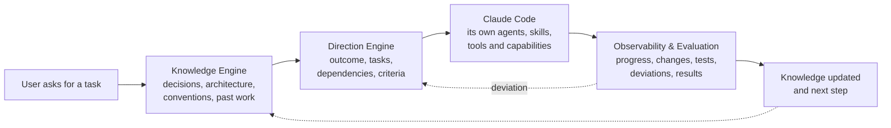

# Roadmap: hat

Status: direction approved by the user 2026-11-11 (identity, flow, priorities). Each track's design doc and tasks
are approved when the user starts them. Inputs: [audit.md](audit.md), [architecture.md](architecture.md),
[global-install.md](global-install.md). Each task becomes an `odd/tasks/` file (or a small-task brief) when the
user starts it.

**hat — Harness Augmentation & Orchestration Toolkit.** An intelligent, extensible layer that enhances AI coding
harnesses, complementing their native capabilities with persistent memory, work direction, coordination,
observability and governance. It doesn't replace the harness; it makes it work better.

hat is this repository evolved, not a new project (user, 2026-11-06): it keeps working at every step and grows a
little at a time.

## 1. Principles

- **Structure and evidence, not rigid rules.** hat doesn't replace Claude's reasoning. It gives it structure
  (outcome, tasks, criteria), evidence (tests, git, telemetry) and ways to correct course (warnings, gates,
  resume points), so the model reasons better. A check informs or stops an action; it never decides the solution.
- **Don't duplicate what the harness does natively without a reason.** When a harness adds a capability that
  covers part of hat, hat evaluates delegating that part to it (§4). hat complements the harness's limits; it
  doesn't compete with its features.
- **Prioritize by the harness's experience and reliability.** A feature goes ahead when it makes the work with
  the harness more reliable or easier to continue, not because it is on a list.
- **Measured against the baseline.** Every feature that adds context or claims to save tokens or time is
  compared with the baseline (§6, *Now*). A feature that doesn't beat it stays opt-in or is dropped. This keeps
  hat from spending more on coordinating than it saves.
- **One step = one release.** Each release is useful on its own; nothing half-built is left in the template.
  A step ends only when every exit criterion has evidence (a test, a command, a report), never on trust.
- **Deterministic before model, read before write, one project before many, policy before execution.**

## 2. The flow

How a task goes through hat once both engines exist. Claude Code does the work with its own agents, skills and
tools; hat prepares it, follows it and learns from it.

| Step | What exists today | What is missing |
|---|---|---|
| Knowledge Engine | session start loads `NEXT_STEPS`, `PROJECT_STATE` and the decision index; OKF validator (K1) | **picking what is relevant to the current task**; one memory model beside the harness's native memory |
| Direction Engine | ODD outcome and criteria, `odd/tasks/` with tasks, dependencies and status, resume against git | the pieces linked into one model; dependencies across projects (M1) |
| Claude Code | hat briefs its agents and never replaces them | — |
| Observability & Evaluation | telemetry per run, pre-PR gate, TDD gate, criteria with evidence | **checking the work against the plan while it runs**, not only at the PR |
| Knowledge updated | `sync-memory`, session handoff, compaction recovery | an automatic update when a task closes (K2, K3) |

What the harness allows (Claude Code, 2026-11-11): context can be added at `SessionStart` and
`UserPromptSubmit`; every tool call is seen at `PostToolUse` and can be warned about or blocked. hat can't see the
model's reasoning or change it from inside: it interrupts and gives evidence, which is the first principle.

## 3. Priorities

Approved by the user 2026-11-11. The earlier phases aren't dropped: their tasks are regrouped under these
priorities (§6), and the order inside each comes from the baseline.

| Priority | Subsystem | Goal | Tasks |
|---|---|---|---|
| P0 | Knowledge Engine | reliable memory | KE1–KE4, K2, K3 |
| P0 | Direction Engine | direction and continuity | DE1–DE3, M1 |
| P1 | Harness Integration | deep integration with Claude Code | H1, H2 |
| P1 | Observability | know what is happening | O1 |
| P1 | Governance | no unauthorized actions | GV1, GV2 |
| P2 | Multi-Harness | Codex and others | GV3, A2 |
| P3 | Intelligence | optimization and learning | C1–C3, A1, TC1, K4, K5, M2–M4 |

Before P0 come the consolidation of v0.9.x and the baseline (§6, *Now*): P0's goals ("reliable", "continuity")
need a metric to be checked off.

## 4. Capability discovery

Harnesses change fast; a feature the vendor ships can make part of hat obsolete. hat keeps track of what each
harness does, and reacts:

| Situation | What hat does |
|---|---|
| The harness adds a capability | detect it and evaluate integrating it |
| The harness improves its memory | use it, and complement only its limits |
| The harness adds hooks | adapt the integrations |
| The harness changes its agents | update the adapter |
| The harness ships something that replaces a hat function | evaluate delegating that function to the harness |

What is automatic and what isn't:

- **Automatic**: hat detects that the harness changed version and that an integration broke (its compatibility
  tests fail, a parser goes `unavailable`). The base exists: `templates/orchestrator/scripts/harness.py` declares
  each capability `verified`, `unverified` or `unsupported`, and [harnesses.md](../harnesses.md) is checked against it.
- **Not automatic**: what a new feature does and whether it replaces something in hat. That needs the harness's
  release notes; hat turns them into a report and the user decides.

This needs versioned adapters and compatibility tests (H1, H2). A known overlap today: Claude Code's native
auto-memory and hat's `memory/` load side by side (KE3 settles it).

## 5. Token cost

Agreed with the user 2026-11-11. Saving tokens is not a third engine: each lever below maps to a task in §6, and
none counts as a saving until the baseline measures it. Savings are judged by **cost**, not raw tokens: a token
read from the prompt cache costs about a tenth of a fresh one, so counting tokens alone overstates what removing
repeated, cached text saves.

| # | Lever | Where hat may save | Task | Today |
|---|---|---|---|---|
| 1 | Token observability | measure input, output, cache and cost by agent, task and project | R5 | built: `telemetry.py` records all four token kinds and an API-equivalent cost, by agent, model, task, run and project; R5 adds the instrumentation's own cost |
| 2 | Context optimizer | only the knowledge, decisions and files the task needs | KE2 | the Knowledge Engine's retrieval; built once, not twice |
| 3 | Task routing | no extra agents or expensive models when a task can be done directly | A1 | model tiers and the small-task path exist; when to work directly or delegate comes from the data |
| 4 | Exploration cache | reuse code exploration while the repo hasn't changed in a relevant way | C1, C2 | gated by D7; keyed by git commit so it never serves stale results |
| 5 | Session compression | state summaries that keep objectives, decisions, results, pending work and references | — | the harness compacts natively; hat complements it (PreCompact save, session handoff, `sync-memory`), each summary checked against git. Improve these, don't add a compressor |
| 6 | Context deduplication | repeated instructions and docs across agents | TC1 | last: repeated static text is mostly cached already; the real cost is agents that start cold and reread code, which levers 2 and 4 address |

Delegating is not free in either direction: the orchestrator runs on the most expensive model and already takes
about 51 % of the tokens, so work done directly avoids a cold start but costs top-tier tokens, and work delegated
costs a cheaper model plus the cold start. Which is cheaper depends on the task type, and A1 settles it per type.

## 6. Steps

Complexity: S (≤ 1 day), M (2–4 days), L (≥ 1 week). Token impact = what the feature adds to a normal session
once shipped. Each track starts with a short design doc that states its metric.

### Done

- **v0.8.0, close F1** (2026-11-10): telemetry contract (R1–R3), session handoff (S1), rename to hat (X3).
- **v0.9.0, global install** (2026-11-10): one install for every project, nothing in the repos; registry and
  `hat status` (X1), `hat doctor`, migrate and cleanup, compaction recovery ([global-install.md](global-install.md)).
- Early starts already shipped: harness capability contract (X2, `harness.py`), projects configure and never fork
  (X4), native OKF v0.2 validator (K1, `knowledge.py`).
- **v0.9.1, v0.9.2**: fixes from live use (CHANGELOG).

### Now · Consolidation and baseline → v0.9.x (fixes only)

- **Goal**: v0.9 solid on real use, and data on where tokens and time go.
- **Exit gate**: V1–V4 each closed with evidence; two weeks of normal work on the registered projects and one
  `metrics` report per project; B1–B5 with n = 3 a side; a one-page `docs/meta-harness/baseline.md` with the
  metrics P0 will be judged by.

**V1 · Docs in sync** · S · README, INSTALL, USAGE, guide and this roadmap say what v0.9 does.
**V2 · Installer and uninstaller review** · M · `scripts/hat_install.py`: what it writes, what `--uninstall`
removes, behaviour with links, other accounts and a partial install; findings fixed in their own PRs.
**V3 · Commit scope** · S · scope to be defined by the user (D11).
**V4 · Migrations and recovery** · M · `scripts/hat_migrate.py` and the recovery paths (handoff, compaction):
each verified on a copy of a real workspace, interrupted runs included.
**R5 · Field data and baseline report** · S (mostly waiting) · main vs agent tokens, by agent type and task size,
coverage, attempts, criteria pass rate, and **the cost of the instrumentation itself**.
**R6 · Benchmark, valid sample** · S, quota-bound · only on the user's go.

### P0 · Knowledge Engine → v0.10.0

- **Goal**: reliable memory. The model gets what this task needs from the project's history, and nothing else.
- **Entry**: baseline. **Decisions**: D2, D3, D4 (D3 and D4 already applied in K1).
- **Exit gate**: on the baseline projects, a resumed session starts from the right point more often and tokens per
  large task don't rise; retrieval never loads more than its budget; nothing failing the secret check is stored.

Four kinds of memory, most already written by hat today:

| Memory | Holds | Today |
|---|---|---|
| Episodic | what happened | `PROGRESS.md`, task-file run logs, telemetry, handoff |
| Semantic | what the project knows | `PROJECT_STATE.md`, project rules, architecture docs |
| Decisional | why a solution was chosen | `DECISIONS.md`, decision records, `decision-index.sh` |
| Procedural | how tasks are done here | the guide, agents, skills, the checklist |

**KE1 · Design doc and metric** · S · the four memories, what each answers, how retrieval is judged.
**KE2 · Retrieval for the current task** · M · deps: KE1, K2 · at `UserPromptSubmit` or step 1 of the flow,
the few entries that match the task (deterministic first: paths, terms, decision ids), within a token budget.
**KE3 · One memory model beside the native one** · S · what goes to the harness's native memory (user
preferences, feedback) and what to hat's (project state, decisions, tasks); no fact kept in both.
**KE4 · Decisions linked to code and tasks** · M · deps: K2 · a decision knows the paths and tasks it affects,
so retrieval can find it from a file.
**K2 · Deterministic export** · M · deps: K1, X1 · `knowledge.py export` from `DECISIONS.md` and done task files;
`sources` point at the originals. Tokens: 0.
**K3 · Query and ODD wiring** · S · deps: K2 · `knowledge.py query`; export runs when a task reaches `done`.

### P0 · Direction Engine → v0.11.0 (can run beside the Knowledge Engine)

- **Goal**: direction and continuity. The work keeps its outcome from request to PR, and a drift is caught while
  it is cheap to fix.
- **Entry**: baseline.
- **Exit gate**: a seeded drift (a file outside the task, repeated failures on one check) is reported during the
  session, not at the PR; no check blocks a legitimate change in the smoke workspace; the warning cost stays
  within its budget.

**DE1 · Design doc and metric** · S · keep objectives, break down tasks, manage dependencies, detect deviations,
validate results, recover course; which exist (ODD) and which are new.
**DE2 · Deviation signals** · M · deps: DE1 · at `PostToolUse`, deterministic signals against the active task
file: files outside its scope, the same check failing again, work on a task whose dependency isn't done. A
signal is evidence shown to the model; it blocks only where a rule of the user's says so.
**DE3 · Course recovery** · S · deps: DE2 · on a signal, the task's outcome, criteria and `Next:` back in context,
and the run log records it.
**M1 · Cross-project dependencies** · S · deps: X1 · `hat status` shows cycles, blocked tasks, stale *Resume* items.

### P1 · Harness Integration

**H1 · Versioned adapters** · S · deps: X2 · each adapter records the harness version it was verified on;
`hat doctor` warns when the installed one is newer; compatibility tests on recorded payloads per version.
**H2 · Capability report** · S · deps: H1 · from the harness's release notes, a report of new capabilities and of
hat functions they may replace (§4); the user decides. Runs on demand or on a schedule, never on its own.

### P1 · Observability

**O1 · Progress against the plan** · M · deps: DE1, R5 · per active task: criteria status, attempts, tokens and
time against its budget, in `hat status` and `telemetry.py report`.

### P1 · Governance

- **Exit gate**: a project cannot loosen a global deny (test); compiled settings keep the user's own entries;
  smoke covers a denied path outside the project and an `ask` on a destructive command; budget warnings appear
  at the configured ceiling and never stop a session.

**GV1 · Policy floor compiled to Claude permissions** · M · deps: X1 · `~/.hat/policy.toml` + project overrides
that only tighten → `permissions` (deny paths outside the project, ask for destructive commands, MCP allowlist).
**GV2 · Budget warnings** · S · deps: R5 (realistic ceilings) · one line to the orchestrator when hit.

### P2 · Multi-Harness

**GV3 · Codex policy compilation** · M · deps: GV1, D6.
**A2 · Codex telemetry adapter** · M · deps: D6, X2 · real payloads first, then the adapter.

### P3 · Intelligence

Built only where the baseline shows the gain (D7); each feature has an A/B with n ≥ 3 or ships opt-in.

**C1 · Symbol and import index** · M · incremental by `git diff`; `ast` for Python, `universal-ctags` otherwise.
**C2 · Queries `where|refs|impact|context`** · M · deps: C1.
**C3 · A/B on B1 and B3** · S, quota · deps: C2, R6.
**A1 · Recommendation table** · M · deps: R5, R6 · tier vs quality and cost per task type, and direct work vs
delegation (§5); never rewires tiers.
**TC1 · Context deduplication** · S · deps: R5 · only if the baseline shows repeated context that isn't cached
(§5).
**K4 · llm-wiki evaluation spike (optional)** · S · deps: K1, D2.
**K5 · Shares and global knowledge** · M · deps: K2, GV1 · knowledge between projects only under policy.
**M2 · Routing recommendation** · S · deps: X2, GV1 · which harness fits a task; recommends, never acts.
**M3 · Opt-in headless dispatch** · L · deps: M2, GV1, R5 · `hat run <project> <task>`; spends quota; never the
default (D8).
**M4 · Safe parallelism** · L · deps: M3, A1.

## 7. Decisions

| # | Decision | Needed by | Recommendation |
|---|---|---|---|
| D1 | What the rename to `hat` covers | done | applied in #26: URLs + name in prose; paths kept |
| D9 | Docs language | done | **decided 2026-11-06: English** |
| D5 | Global location | done | **changed 2026-11-10**: `~/.hat/`; see [global-install.md](global-install.md) §9 |
| D10 | Identity, flow, priorities and token cost | done | **decided 2026-11-11**: the identity above, §2, §3 and §5 |
| D11 | What V3 (commit scope) covers | Now | the user's |
| D2 | llm-wiki has no licence | Knowledge Engine | native provider; ask the author; optional provider if licensed |
| D3 | OKF version | Knowledge Engine | v0.2, pinned per bundle; read v0.1 with fallbacks (applied in K1) |
| D4 | YAML parsing | Knowledge Engine | stdlib subset; PyYAML when present (applied in K1) |
| D6 | Install Codex | P2 | when Codex matters for real work |
| D7 | Which intelligence track first, and whether C1–C3 are built | P3 | from the baseline: C1 only if exploration ≥ ~20 % of tokens |
| D8 | Headless dispatch | P3 | opt-in per task, after governance |

## 8. Risks

| Risk | Effect | Mitigation |
|---|---|---|
| Coordination overhead (orchestrator already ~51 % of tokens) | hat costs more than it saves | every gate compares with the baseline by cost (§5); a context budget per engine; defaults only after a measured gain |
| A harness feature makes part of hat obsolete | duplicated work, two sources of truth | capability discovery (§4); delegate to the harness when it covers the need |
| Rigid checks get in the model's way | false blocks, worse work | signals are evidence; blocking only on the user's rules; a false-positive case in each gate |
| Claude transcript format is private | usage turns `unavailable` after an update | parser versioned, coverage in every report, H1 warns on a new version |
| OKF young and vendor-driven | bundles need migrating | pin `okf_version`; Markdown stays the truth; bundles re-exportable |
| Codex unavailable | "runtime agnostic" untested | capabilities declare only what's verified; no forced parity |
| Benchmarks spend quota | small samples read as results | n ≥ 3 enforced in code; runs only on the user's go |
| Scope (one maintainer) | half-built layers | each step ships alone; P2 and P3 can be cut without breaking P0 and P1 |
| Cross-project leaks | one project's data reaches another | read-only registry, allowlisted shares, secret check, governance before sharing |

## 9. Next step

Consolidation (V1–V4) while the baseline collects data (R5). The two P0 design docs (KE1, DE1) can be written
in the meantime; their code waits for the baseline.
